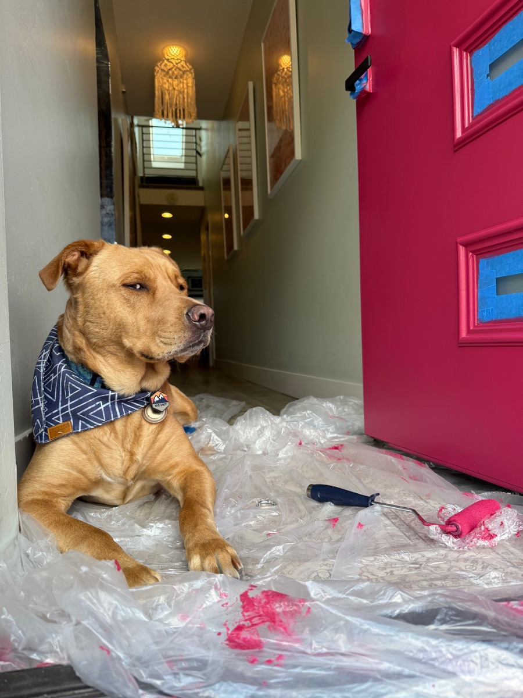
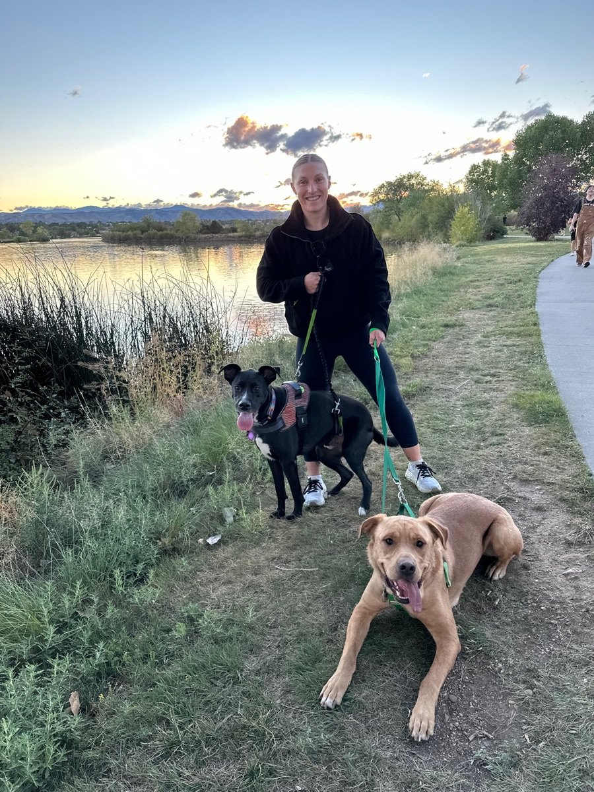

::: {#main role="main"}

::: {.hero .hero-compact .hero-about}
::: {.wrap}
[[//]{aria-hidden="true"} about]{.mono-label}

# Hi, I'm Casey. {#about-title}

[Data Scientist & R Shiny Specialist · Indianapolis area]{.resume-title}
:::
:::

::: {#about .wrap .page-section}
::: {.about}
```{=html}

```

::: {.about-body}
I'm a contract data scientist and an experienced R Shiny developer based in the Indianapolis area. Before that, I spent several years at Atorus Research as a lead Shiny developer on clinical research apps, taking them from the first wireframes through modular, production-ready code. Alongside the development work, I led projects day to day: working directly with stakeholders and clients, planning and managing timelines, and mentoring the developers on my teams.

My background is a mix that shows up in my work: I studied biostatistics and statistics, with a minor in graphic design, and I've spent years writing production code, from clinical programming in R to complex Shiny architecture. I care as much about how an app looks and feels as about how it's built. Data deserves better than dashboards that feel like chores.

::: {.work-on}
[What I work on]{.mono-label}

shiny
: Modular apps, golem, bslib, R6

js
: Custom htmlwidgets, JavaScript and D3

ux
: User research, wireframes, prototypes, style guides

css
: Custom HTML/CSS and branded, polished interfaces

clinical
: CDISC, PK/PD, tables, listings and figures
:::
:::
:::

::: {.dogs}
[[//]{aria-hidden="true"} off the clock]{.mono-label}

## Meet my coworkers {#dogs-heading}

Mason and Tony work behind the scenes on every project. They attend all my meetings and sleep through most of them.

```{=html}
<div class="dogs-grid">
  <figure>
    
    <figcaption><strong>Mason</strong> reviews my code from very close range.</figcaption>
  </figure>
  <figure>
    
    <figcaption><strong>Tony</strong> supervises every project, DIY and professional.</figcaption>
  </figure>
  <figure>
    
    <figcaption>The whole team, out for a sunset walk.</figcaption>
  </figure>
</div>
```
:::
:::

::: {#contact .contact}
::: {.wrap .contact-inner}
::: {.contact-text}
[[//]{aria-hidden="true"} contact]{.mono-label}

## Let's talk about your project, team, or talk idea. {#contact-heading}
:::

::: {.contact-actions}
[97caguilar@gmail.com](mailto:97caguilar@gmail.com){.btn-cta}

::: {.contact-links}
[LinkedIn [↗]{aria-hidden="true"}](https://www.linkedin.com/in/casey-aguilar-gervase/)
[GitHub [↗]{aria-hidden="true"}](https://github.com/caseyag)
:::
:::
:::
:::

:::
