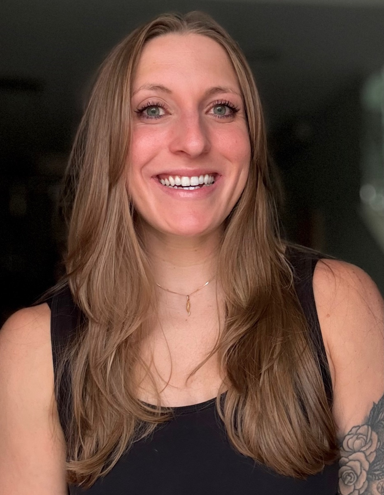
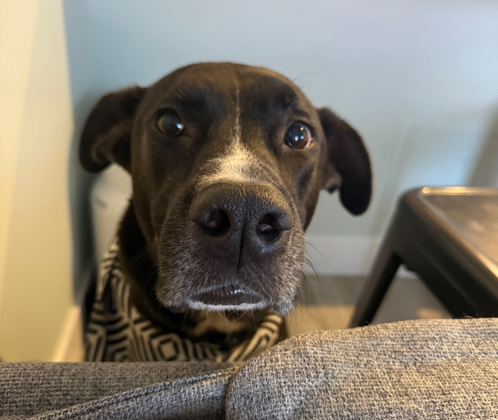

::: {#main role="main"}

::: {.hero .hero-compact .hero-about}
::: {.wrap}
[[//]{aria-hidden="true"} about]{.mono-label}

# Hi, I'm Casey. {#about-title}

[Data Scientist, R Shiny Specialist & UI/UX Designer · Indianapolis area]{.resume-title}
:::
:::

::: {#about .wrap .page-section}
::: {.about}
```{=html}

```

::: {.about-body}
I'm a contract data scientist and an experienced R Shiny developer based in the Indianapolis area. Before that, I spent several years at Atorus Research as a lead Shiny developer on clinical research apps, taking them from the first wireframes through modular, production-ready code. Alongside the development work, I led projects day to day: working directly with stakeholders and clients, planning and managing timelines, and mentoring the developers on my teams.

My background is a mix that shows up in my work: I studied biostatistics and statistics, with a minor in graphic design, and I've spent years writing production code, from clinical programming in R to complex Shiny architecture. I care as much about how an app looks and feels as about how it's built. Data deserves better than dashboards that feel like chores.

:::
:::

```{=html}
<div class="folder" id="work-on">
  <p class="mono-label folder-label" id="work-on-label">What I work on</p>
  <div class="folder-tabs" role="tablist" aria-labelledby="work-on-label">
    <button type="button" role="tab" id="tab-shiny" aria-controls="panel-shiny" aria-selected="true" tabindex="0">shiny</button>
    <button type="button" role="tab" id="tab-js" aria-controls="panel-js" aria-selected="false" tabindex="-1">js</button>
    <button type="button" role="tab" id="tab-ux" aria-controls="panel-ux" aria-selected="false" tabindex="-1">ux</button>
    <button type="button" role="tab" id="tab-css" aria-controls="panel-css" aria-selected="false" tabindex="-1">css</button>
    <button type="button" role="tab" id="tab-clinical" aria-controls="panel-clinical" aria-selected="false" tabindex="-1">clinical</button>
  </div>
  <div class="folder-panel" role="tabpanel" id="panel-shiny" aria-labelledby="tab-shiny" tabindex="0">
    <h3>R Shiny</h3>
    <p>Modular apps, golem, bslib and R6, from the first wireframe to production.</p>
    <p class="folder-seen"><span>See it in:</span> <a href="../work/report-generator/index.html">Report Slide Generator</a> · <a href="../work/app-refactor/index.html">Shiny App Health Check & Refactor</a></p>
  </div>
  <div class="folder-panel" role="tabpanel" id="panel-js" aria-labelledby="tab-js" tabindex="0" hidden>
    <h3>JavaScript & htmlwidgets</h3>
    <p>Custom htmlwidgets, JavaScript and D3 for charts and tables that go beyond what R packages offer.</p>
    <p class="folder-seen"><span>See it in:</span> <a href="../work/biomarker-explorer/index.html">Biomarker Explorer</a> · <a href="../work/handsome-table/index.html">Handsome Table</a></p>
  </div>
  <div class="folder-panel" role="tabpanel" id="panel-ux" aria-labelledby="tab-ux" tabindex="0" hidden>
    <h3>UI/UX design</h3>
    <p>Talking with stakeholders and turning those conversations into clear feature requirements. User research, wireframes, prototypes and style guides, designed in Figma or Claude Design.</p>
  </div>
  <div class="folder-panel" role="tabpanel" id="panel-css" aria-labelledby="tab-css" tabindex="0" hidden>
    <h3>HTML & CSS</h3>
    <p>Custom HTML and CSS for branded, polished interfaces that feel like the client's own tools.</p>
    <p class="folder-seen"><span>See it in:</span> <a href="../work/report-generator/index.html">Report Slide Generator</a> · <a href="../work/app-refactor/index.html">Shiny App Health Check & Refactor</a></p>
  </div>
  <div class="folder-panel" role="tabpanel" id="panel-clinical" aria-labelledby="tab-clinical" tabindex="0" hidden>
    <h3>Clinical data</h3>
    <p>CDISC, PK/PD, and tables, listings and figures, from my biostatistics and clinical programming background.</p>
  </div>
</div>
<script>
(function () {
  var tabs = Array.prototype.slice.call(document.querySelectorAll('#work-on [role="tab"]'));
  function select(tab, focus) {
    tabs.forEach(function (t) {
      var on = t === tab;
      t.setAttribute('aria-selected', on ? 'true' : 'false');
      t.tabIndex = on ? 0 : -1;
      document.getElementById(t.getAttribute('aria-controls')).hidden = !on;
    });
    if (focus) tab.focus();
  }
  tabs.forEach(function (tab, i) {
    tab.addEventListener('click', function () { select(tab, false); });
    tab.addEventListener('keydown', function (e) {
      var next = null;
      if (e.key === 'ArrowRight') next = tabs[(i + 1) % tabs.length];
      else if (e.key === 'ArrowLeft') next = tabs[(i - 1 + tabs.length) % tabs.length];
      else if (e.key === 'Home') next = tabs[0];
      else if (e.key === 'End') next = tabs[tabs.length - 1];
      if (next) { e.preventDefault(); select(next, true); }
    });
  });
})();
</script>
```

::: {.dogs}
[[//]{aria-hidden="true"} off the clock]{.mono-label}

## Meet my coworkers {#dogs-heading}

Mason and Tony work behind the scenes on every project. They attend all my meetings and sleep through most of them.

```{=html}
<div class="dogs-grid">
  <figure>
    
    <figcaption><strong>Mason</strong> reviews my code from very close range.</figcaption>
  </figure>
  <figure>
    
    <figcaption><strong>Tony</strong> supervises every project, DIY and professional.</figcaption>
  </figure>
  <figure>
    
    <figcaption>The whole team, out for a sunset walk.</figcaption>
  </figure>
</div>
```
:::
:::

::: {#contact .contact}
::: {.wrap .contact-inner}
::: {.contact-text}
[[//]{aria-hidden="true"} contact]{.mono-label}

## Let's talk about your project, team, or talk idea. {#contact-heading}
:::

::: {.contact-actions}
[97caguilar@gmail.com](mailto:97caguilar@gmail.com){.btn-cta}

::: {.contact-links}
[LinkedIn [↗]{aria-hidden="true"}](https://www.linkedin.com/in/casey-aguilar-gervase/)
[GitHub [↗]{aria-hidden="true"}](https://github.com/caseyag)
:::
:::
:::
:::

:::
