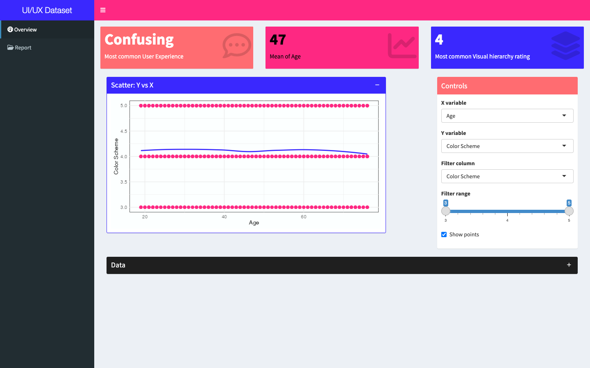
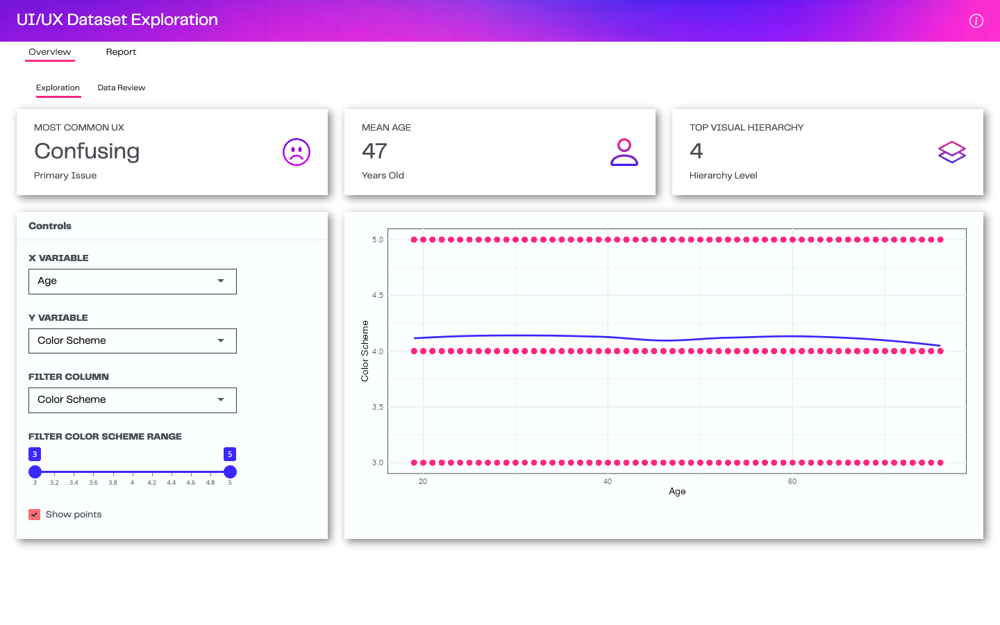
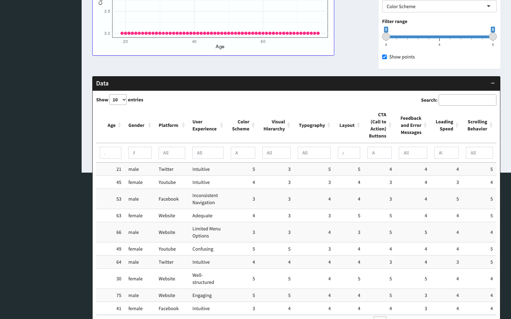
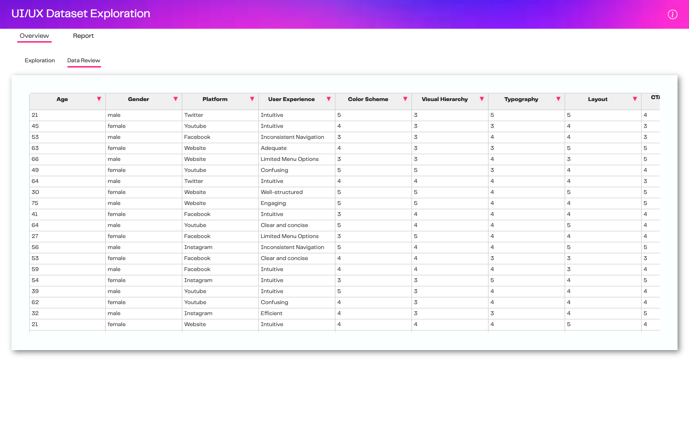

We first gave this talk at posit::conf(2025) and presented it again at PHUSE in March 2026. In it, we take a working client Shiny app and rebuild it step by step, one design lever at a time.

::: {.cta-row}
[Watch on YouTube [↗]{aria-hidden="true"}](https://www.youtube.com/watch?v=RQod46DSkiA){.btn-cta}
[View the code on GitHub](https://github.com/caseyag/Posit-Conf-25){.btn-outline}
:::

## Watch the talk



## The problem

The client's Shiny app worked, but it was hard to use. Navigation was inconsistent, color competed for attention everywhere, and tables and actions gave users little guidance.

## Before and after

These screens use the public UX survey dataset from the talk.

::: {layout-ncol=2}
{fig-alt="Original app overview with a dark sidebar and solid color value boxes"}

{fig-alt="Redesigned app overview with a light layout and white summary cards"}
:::

::: {layout-ncol=2}
{fig-alt="Original app with the data table in a box at the bottom of the page"}

{fig-alt="Redesigned app with a Data Review tab showing a filterable table"}
:::

## The four design levers

1. **Layout.** A cohesive experience starts with a clear structure: intuitive user journeys, consistent flow and streamlined grid layouts that make navigation familiar.
2. **Color.** The original app followed brand guidelines. The redesign uses color on purpose, as an accent that highlights key information and actions without overwhelming the user.
3. **Typography.** One client font, with hierarchy built from size and weight to guide attention and improve readability.
4. **Components.** [Handsome Table](../../work/handsome-table/index.qmd), a custom Handsontable wrapper, for friendlier tables; tooltips and popovers for extra detail without clutter; and visual feedback for every action, with a confirmation step for serious ones like deletions.

## Code and apps

The original app and the redesigned version are in the talk repo. Each step of the talk has its own branch.
