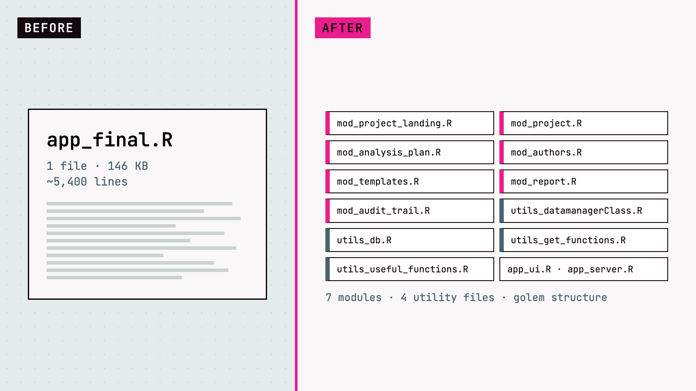
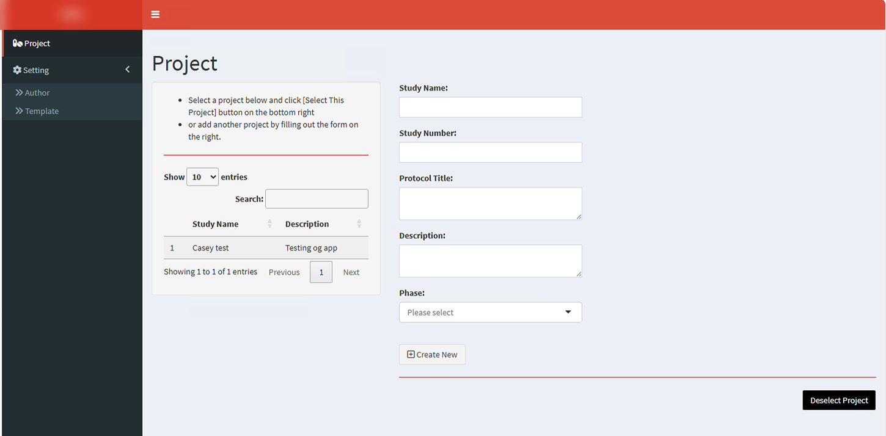
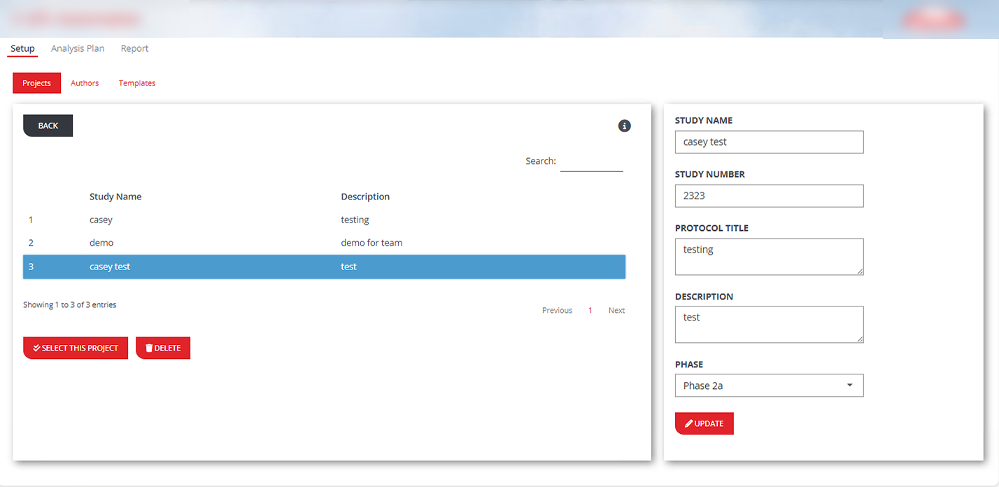
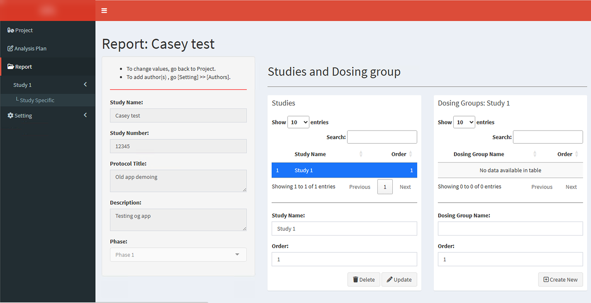
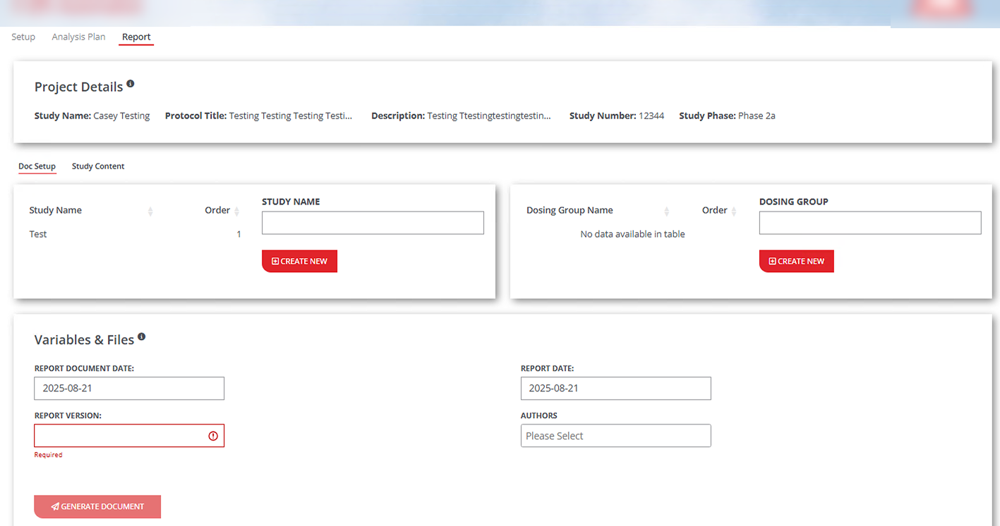
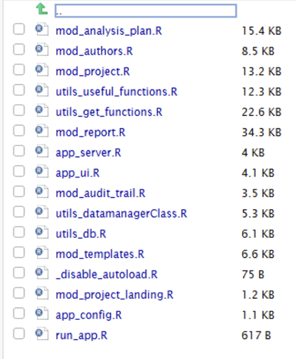
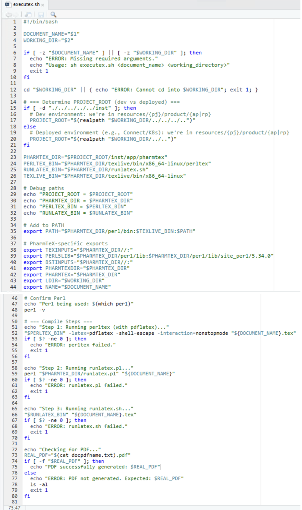

A pharma client had a clinical reporting app that worked, but the whole thing lived in one file. I led a health check and refactor to make it maintainable, faster and ready for production.

## The problem

The app was a single `app_final.R`: about 5,400 lines and 146 KB. Every change risked breaking something else, several core functions were slow, and the app only ran locally. The client needed it running in production on Posit Connect, with PDF reporting built in.

{fig-alt="Before and after: one 146 KB app_final.R file, then twelve focused module and utility files"}

## Before and after

The same two screens in the original app and in my redesign. Click any screenshot to enlarge it. The app name and the client's logo are blurred, and the data is test data.

::: {.column-page layout-ncol=2}
{fig-alt="Original app project screen with a dark sidebar, a red header and a plain form"}

{fig-alt="Redesigned project screen with Setup, Analysis Plan and Report tabs, a project table and an edit form"}
:::

::: {.column-page layout-ncol=2}
{fig-alt="Original app report screen with study and dosing group tables and nested sidebar navigation"}

{fig-alt="Redesigned report screen with a project details summary, study and dosing group panels, and a form showing a required-field message"}
:::

## Designing with a tough brand kit

The client's brand palette is mostly red, and red everywhere reads as alarm in an app people use for hours. I kept red as the main brand color but saved it for the things that matter: active tabs, primary buttons and required fields. White space and black text carry the rest of the layout, so the app feels calm and breathable while still clearly on brand. Where I could, I brought in the palette's lighter secondary blue for headers and selected rows, which softens the red without leaving the brand.

## What I did

- **Health diagnostic and estimate.** I reviewed the app end to end, mapped where the complexity lived, and gave the client a development estimate and a clear path forward.
- **Modularized the monolith.** I split the single script into feature modules for projects, analysis plans, authors, templates, reports and an audit trail, plus utility files for data management, the database and shared helpers, all in a standard golem structure.

    {fig-alt="File list showing mod_analysis_plan.R, mod_authors.R, mod_project.R, mod_report.R, mod_audit_trail.R, mod_templates.R and utility files with their sizes" width="420"}
- **Designed and built a new UI.** I designed the refreshed interface in Figma, then built it out myself in the new module structure.
- **Made it faster.** I streamlined and rewrote core functions for efficiency.
- **Took it to production.** I worked out what had to change to move from a local app to Posit Connect, and deployed it there.
- **Got PDF reporting working on Posit Connect.** I implemented PharmTeX for LaTeX-based PDF reports. The hardest part was the server: the TeX toolchain had to run inside Posit Connect, where paths and the environment differ from a local machine. I wrote wrapper scripts for Windows and Linux, and the Linux one detects where it's running so the same app works locally and on Connect.

    {fig-alt="Bash script executex.sh that resolves the project root for dev or deployed environments, exports PharmTeX paths, and runs perltex, runlatex.pl and runlatex.sh with error checks" width="560"}

## How I ran it

I led the project day to day: clear documentation and timelines, regular updates to both the client and my own team, and a written trail of plans and decisions that kept everyone aligned and accountable.

## What I'd do again

- **Dig deep in the diagnostic.** Hidden complexity surfaces early when the first review goes beyond the code.
- **Build in buffer time.** New technical dependencies like PharmTeX bring unknowns that are hard to estimate.
- **Modularize early.** The sooner an app is organized into modules, the cheaper every later change becomes.
