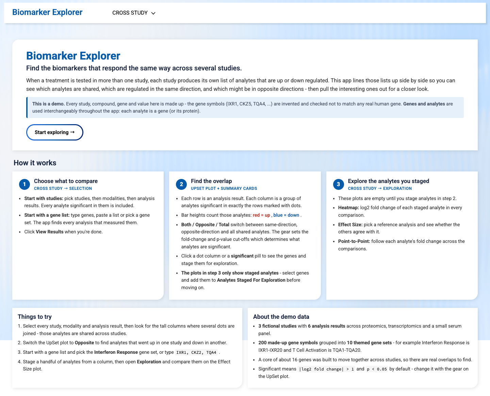

I designed and built a cross-study biomarker app for a pharma client's scientists. This public version is a rebuild with invented data, so you can try it.

::: {.cta-row}
[Launch the demo [↗]{aria-hidden="true"}](https://caseya-g.shinyapps.io/biomarker-explorer/){.btn-cta}
:::

## The problem

When a treatment is tested in several studies, each study produces its own list of analytes that went up or down. Scientists needed one place to line those lists up, find the analytes that respond the same way across studies, and look closely at the interesting ones.

## My role

I led design and front-end development on a team of four. That covered wireframes and user flows with the scientists, the visual design, and the custom plotting layer.

## What I built

- **Ten custom htmlwidgets:** volcano, UpSet, heatmap, correlation, cross-study heatmap, effect size, point-to-point, box, spaghetti and summary-line plots.
- **One shared plotting library.** All ten widgets use a small in-house JavaScript library for their theme, tooltips and dependency checks, so they look and behave as one system.
- **D3 and Observable Plot, each where it fits.** Clustering runs in R, and the D3 heatmaps draw the prepared cells, dendrograms and annotation tracks. Distribution and trend plots use Observable Plot with a custom zoom layer.
- **Charts as inputs.** The UpSet plot sends mode changes and analyte picks back to Shiny, so a selection in the chart drives the rest of the app.

## The demo

{fig-alt="Biomarker Explorer landing page with a How it works section in three steps"}

Every study, compound, gene and value in the demo is made up. The original app and its data stay private to the client.
