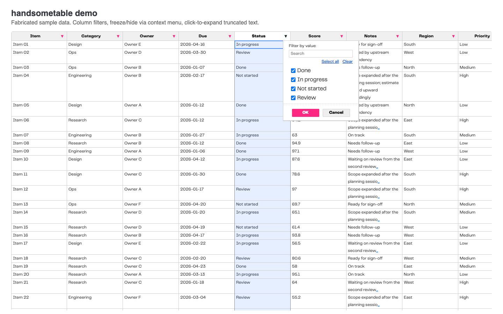

Handsome Table wraps the Handsontable JavaScript library as an htmlwidget, giving R and Shiny apps a spreadsheet-style table with styling that fits the app around it. It powers the data review tab in the app redesign from our posit::conf(2025) talk, [Design of Everyday Shiny Apps](../../talks/design-of-everyday-apps/index.qmd).

## Try it

::: {.column-page}
```{=html}
<iframe class="demo-frame" src="demo/index.html" title="Live Handsome Table demo with made-up data" loading="lazy"></iframe>
```
:::

## What it does

- **A one-line R API.** `handsome_table(df)` turns a data frame into a table, and `handsome_tableOutput()` and `renderHandsome_table()` drop it into Shiny.
- **Readable long text.** A custom cell renderer truncates notes at 40 characters and expands them on click.
- **Per-column filters.** Each column has a filter-by-value menu with search.
- **Freeze and hide from the header.** A right-click menu freezes, unfreezes, hides and unhides columns, and it tracks column order so a freeze can be undone cleanly.
- **Fits the page.** Columns resize, headers wrap, the height follows the window, and the styling matches the app.

{fig-alt="Handsome Table with the Status column filter menu open"}

## What's next

- Editable cells with dropdown, date and checkbox column types
- Two-way binding, so edits flow back to R
- Validation rules
- A package release with documentation and tests
