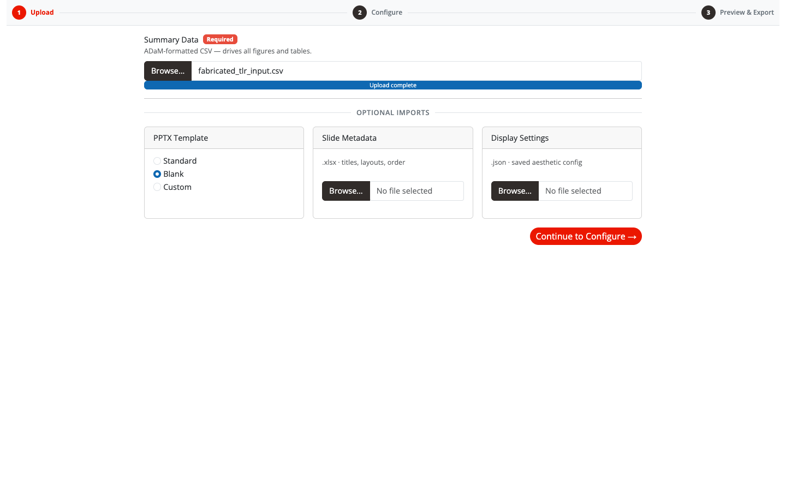
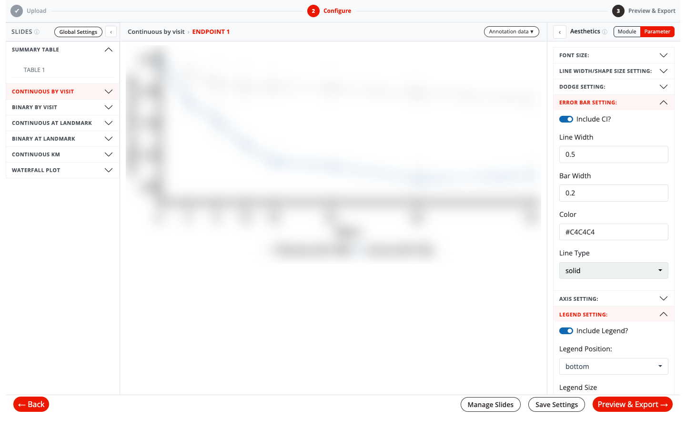
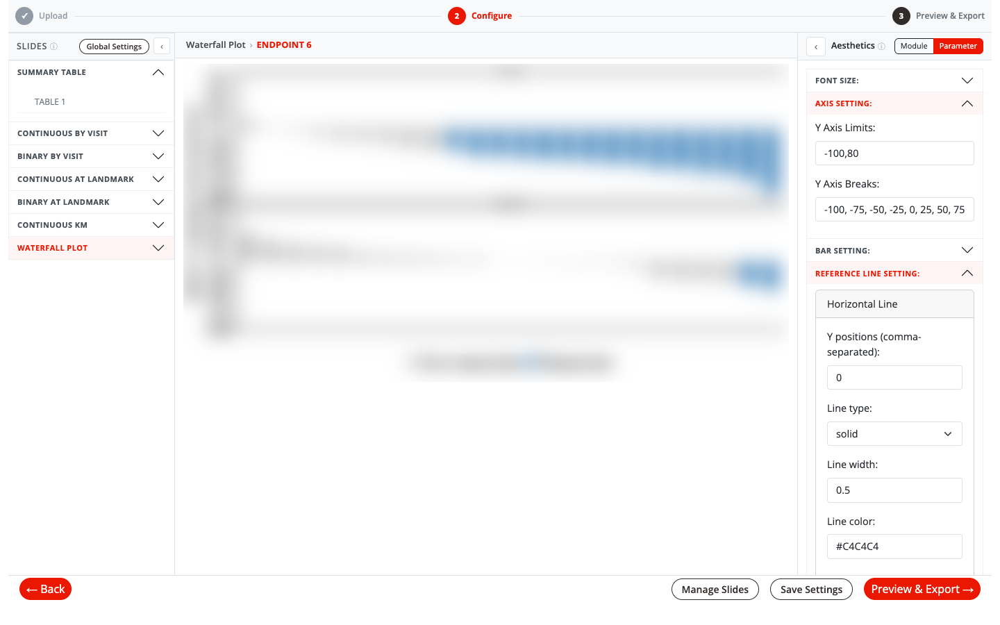
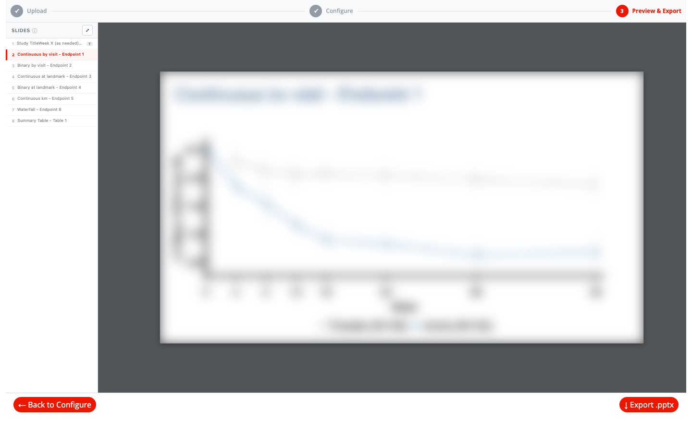

A redesign of a pharma client's tool that turns a prepared data file into a ready-to-edit topline report deck. The screenshots use invented data with the plots blurred, and the client's name and logo are removed.

## The problem

The client already had a working app that could export PowerPoint decks, but it was hard to find your way through, and you couldn't see the slides until after you exported. You could watch each figure change while configuring it, but checking the finished deck meant exporting, opening the file, then going back into the app to fix anything and exporting again. The app needed a more intuitive flow and a way to review the deck without leaving it.

## My role

The client's team had built the original app and its figure code. I redesigned it: I reorganized and repurposed their code into a cleaner structure, aligned the app with the client's brand, designed a new step-by-step workflow, and built the in-browser PowerPoint preview, which was the biggest piece of the project.

## How it works

The app is three steps, **Upload → Configure → Preview & Export**, with a progress indicator that is always visible.

{fig-alt="Upload step with a three-step progress indicator and a completed file upload"}

{fig-alt="Configure step with a slide list, a blurred plot and an aesthetics panel"}

{fig-alt="Configure step showing waterfall plot controls with the plot blurred"}

{fig-alt="Preview step with a slide list and a blurred slide preview"}

## What I did

- **A live PowerPoint preview widget.** This was the biggest piece. I built a custom htmlwidget so users see the real deck before they download it: officer builds the .pptx on the server, the file goes to the browser, and a client-side renderer draws the slides, which users can reorder. The preview and the download use the same file, so they can't drift apart, and users can review the deck, go back to adjust a slide and check it again without ever leaving the app.
- **A new UX flow.** I replaced the original layout with a three-step workflow, Upload → Configure → Preview & Export, with a progress indicator and a consistent three-pane configure screen: slides on the left, the figure in the middle, and its settings on the right.
- **Brand alignment.** I brought the app's colors, type and components in line with the client's brand, so it feels like one of their own tools.
- **A reorganized codebase.** I repurposed the client's existing figure code (eleven figure types plus summary tables) into a three-layer module design: a pure plotting function, a tab module that wires settings into it, and a dynamic layer that builds one tab per parameter in the upload. Axis, legend, error-bar and color controls became shared modules, with module-wide defaults that each parameter can override.
